# Doctors For You (DFY) — HR Operations Platform & Smart Document Staging Pipeline

[](https://www.python.org/)
[](https://flet.dev/)
[]()
[]()

An enterprise-ready, offline-first Desktop HRMS Application engineered for **Doctors For You (DFY)**. It automates end-to-end human resources operations across 50+ medical, technical, and administrative designations—unifying candidate recruitment, multi-sheet interview tracking, 74-column Keka HRMS synchronization, intelligent document generation with human-in-the-loop review staging, sequential reference number stamping, automated email dispatch, and an offline Hinglish HR policy copilot.

---

## 📑 Table of Contents
1. [Architecture Overview](#-architecture-overview)
2. [1-Click Quick Start (Windows)](#-1-click-quick-start-windows)
3. [Sharing & Testing Standalone Package](#-sharing--testing-standalone-package)
4. [Key Features & Capabilities](#-key-features--capabilities)
5. [Repository Structure](#-repository-structure)
6. [Automated Test Suite & Verification](#-automated-test-suite--verification)
7. [System Requirements & Dependencies](#-system-requirements--dependencies)

---

## 🏛️ Architecture Overview

The system is built on an offline-first, layered architecture prioritizing data integrity, speed, and seamless non-technical usability. Detailed architectural specifications and data flow diagrams are available in [docs/ARCHITECTURE.md](docs/ARCHITECTURE.md).

```mermaid
graph TD
    subgraph UI_Layer [Presentation Layer - Flet Desktop GUI]
        DASH[Executive Bento Dashboard]
        JOIN[Candidate Joining & Multi-Sheet Preview]
        KEKA[Keka Master Sync & Duplicate Guard]
        STAGE[Smart Rule Detector & Staging Hub]
        MANUAL[Manual Document Generator]
        HELP[Help Center & Offline Hinglish Copilot]
        SETT[Settings & Encrypted Credentials]
    end

    subgraph Service_Layer [Business Logic & Service Layer]
        DASH_SVC[Dashboard & Metrics Service]
        SHEET_SVC[Sheet Processor & Column Normalizer]
        KEKA_SVC[Keka Sync & Conflict Resolver]
        RULE_SVC[Smart Rule Detector Service]
        STAGE_SVC[Document Staging & Dispatch Engine]
        DOC_SVC[Document Generation & Formatting Service]
        PDF_SVC[Word COM PDF Converter]
        EXCEL_SVC[Professional OpenPyXL Excel Styler]
        LAUNCH_SVC[Native OS File & Explorer Launcher]
        COPILOT_SVC[Offline Policy Search & AI Copilot]
        EMAIL_SVC[Encrypted SMTP & Gmail Dispatcher]
    end

    subgraph Data_Layer [Data & Persistence Layer]
        SQLITE[(SQLite hrms.db)]
        CIPHER[Fernet Encrypted Secrets]
        DOCX_TPL[Word Template Bank: 50+ Letters]
        POLICY_DB[DFY Policy Knowledge Base JSON]
    end

    UI_Layer --> Service_Layer
    Service_Layer --> Data_Layer
```



---

## 🚀 1-Click Quick Start (Windows)

No command prompt or terminal setup is required for standard operation.

### Step 1: Install Python (If Not Already Installed)
1. Download Python 3.10+ from **[https://www.python.org/downloads/](https://www.python.org/downloads/)**.
2. **IMPORTANT**: On the first installer screen, enable:  
   `☑ Add python.exe to PATH`
3. Click **Install Now**.

### Step 2: Double-Click the Launcher
- In the repository root (or inside `desktop_app/`), double-click:
  ```
  Launch_DFY_HRMS.bat
  ```
- **Automatic Setup**: The batch script probes your environment (`.venv`, `venv`, system Python), checks required libraries (`flet`, `pandas`, `openpyxl`, `python-docx`, `pywin32`, `cryptography`, etc.), auto-installs missing dependencies from `requirements.txt` on first launch, and opens the application window.

### Step 3 (Optional): Desktop Shortcut
To create a Windows Desktop shortcut, run:
```cmd
Launch_DFY_HRMS.bat --create-shortcut
```

---

## 📦 Sharing & Testing Standalone Package

The `desktop_app/` folder is **completely self-contained**:
- It contains its own SQLite database (`data/hrms.db`), cryptographic keys (`data/secret.key`), company logo assets (`assets/`), complete categorized Word templates (`templates/`), offline knowledge manuals (`knowledge/`), and standalone launchers (`Launch_DFY_HRMS.bat`).
- **To distribute to another system:**
  1. Compress the `desktop_app` folder into a `.zip` file.
  2. Send the `.zip` file to the recipient.
  3. Extract anywhere on the target machine and double-click `Launch_DFY_HRMS.bat`.
  4. The application detects the standalone environment and functions 100% out of the box with zero external folder dependencies.

---

## 🌟 Key Features & Capabilities

### 1. Executive Bento Dashboard (`pages/dashboard_page.py`)
- Real-time command center displaying 4 live, clickable action cards:
  - **🎉 Pending Welcome Emails**: Count of selected candidates awaiting welcome emails (1-click navigation to review queue).
  - **🔍 Letters to Generate**: Staff members detected from Keka sheets needing official letters (1-click navigation to Smart Detector).
  - **🚀 Staged Ready for Final Go**: Letters generated and waiting in the staging quality gate (1-click navigation to Staging Hub).
  - **👥 Total in Pipeline**: Active candidates currently in the screening and interview pipeline.
- Live operations activity log showing recent email dispatches, candidate status updates, and sync events.

### 2. Candidate Joining Process & Multi-Sheet Preview (`pages/joining_process_page.py`)
- Ingests multi-sheet recruitment trackers (e.g. `PPSA INTERVIEW CHART.xlsx`).
- **Inline Multi-Sheet Visual Inspection**:
  - Interactive sheet switcher tabs (*Phase 1*, *Phase 2*, *Interview Round 2*).
  - KPI metrics strip showing Candidate Count, Selected, and In-Process tallies.
  - 10-row data table preview.
  - Post-ingestion action cards (`Review & Send Welcome Emails`, `Generate Offer Letters`, `Export Staged Candidates`).
- **Multi-Round Interview Tracking**: Candidates interviewing 2–5 times across multiple rounds are tracked with complete round history without creating duplicate employee records.
- **Welcome Email Review & Bulk Dispatch**: Filter `🎉 Selected (Pending Welcome Email)` and batch-send personalized congratulatory emails with a live progress dialog.

### 3. Keka Master Synchronization & Duplicate Protection (`pages/keka_sync_page.py`)
- Ingests 74-column Keka HRMS employee master exports (`.xlsx`, `.csv`).
- **Dynamic Header Offset Detection**: Automatically detects table headers even when Keka exports prepend company logos or titles on Rows 0 and 1.
- **Zero Duplicate Employee Guarantee**:
  - Employee IDs are strictly unique per staff member.
  - **Pre-Sync Warning & Resolution Dialog**: If duplicate employee numbers or a sheet re-upload is detected, the system displays side-by-side field differences and gives HR the interactive choice:
    1. `🔄 Update Existing with Sheet Data`: Updates designation, salary, or dates while preserving employee history.
    2. `🛡️ Keep Database Records (Skip Sheet Duplicates)`: Preserves current database records and only imports new staff.

### 4. Smart Document Pipeline & Staging Hub (`pages/document_generation_page.py`)
- **Tab 1: 🔍 Smart Detection & Generator**
  - Evaluates employee status against Keka data to classify document needs:
    - *Active / Joined without prior offer* ➔ **Offer Letter**
    - *Extension of Service Till present* ➔ **Extension Letter**
    - *Salary revision detected* ➔ **Increment Letter**
    - *Exit Date / Resignation present* ➔ **Experience & Relieving Certificate**
    - *Disciplinary or termination recorded* ➔ **Termination Letter**
  - Allows HR users to override suggested letter types via an inline dropdown.
  - Generates draft letters into the staging queue **without consuming official reference sequence numbers**.
- **Tab 2: 📋 Staging & Final Review Hub (Quality Gate)**
  - **👁️ Preview**: 1-click preview in Microsoft Word or default PDF viewer.
  - **✏️ Fix Details**: Edit employee name, salary, dates, or designation ➔ **instantly regenerates the document** and updates the preview.
  - **Format Selector**: Choose `PDF` (default) or `DOCX` per candidate.
  - **`[ 🚀 Final Go: Dispatch Selected ]`**:
    - Atomically increments and commits official reference numbers sequentially.
    - Re-stamps documents with permanent reference numbers.
    - Converts to PDF (via Microsoft Word COM automation).
    - Dispatches email with the document attached via encrypted SMTP / Gmail API.
    - Writes permanent audit log records.
- **Tab 3: ✍️ Manual One-Off Generator**
  - Select any employee and generate single customized letters on demand.

### 5. Word Template Date & Reference Header Alignment Fix
- **Root Problem Solved**: Prior space-padding string concatenation between `Ref: DFY/...` and `Date: DD/MM/YYYY` wrapped onto new lines depending on printer margins and font variations.
- **Engineered Solution**: Replaced with a 1-row, 2-column borderless Word table (`w:cantSplit`, left column left-aligned, right column right-aligned). Guarantees 100% horizontal alignment and zero line-wrapping across all Word template variations.

### 6. Executive OpenPyXL Excel Styling Engine (`excel_export_service.py`)
- All Excel exports (Candidate tables, Daily Briefing 2-sheet workbooks, Unmatched reports) feature:
  - DFY Corporate Navy (`#0B5ED7`) headers with bold white text.
  - Soft ice-blue zebra striping (`#F1F5F9`) for easy row reading.
  - Indian Rupee currency formatting (`₹#,##0`) on compensation columns.
  - Auto-fitted column widths preventing cell truncation (`###`).

### 7. 1-Click Native OS File & Folder Launcher (`utils/file_launcher.py`)
- Every export triggers an interactive modal with:
  - `📂 Open File`: Instantly opens the file in Excel, Word, or Adobe Reader.
  - `📁 Open Folder`: Opens Windows Explorer with the generated file highlighted.

### 8. Help Center & Offline Hinglish AI Copilot (`pages/help_page.py`)
- **Interactive Knowledge Center**: Searchable step-by-step guides for all platform workflows.
- **100% Offline Hinglish HR Copilot**:
  - Built-in knowledge base containing all 10 Articles of the official **Doctors For You (DFY) HR Policy Manual** (Attendance, Leave Policy, Code of Conduct, Travel Reimbursement, Disciplinary Policy, etc.).
  - Works with zero internet and without requiring third-party AI API keys.
  - HR staff can type questions in English or Hinglish (e.g., *"Casual leave kitni milti hai?"*, *"Travel allowance claim kaise karein?"*) and get instant, accurate answers citing policy articles.

---

## 📂 Repository Structure

```
Suraj HR Project/
├── Launch_DFY_HRMS.bat            # 1-Click root launcher (probes env & auto-installs deps)
├── Install_Dependencies.bat       # Manual 1-click dependency installer
├── requirements.txt               # Pinned package requirements
├── README.md                      # Master repository documentation (this file)
├── docs/
│   ├── ARCHITECTURE.md            # System architecture and technical design
│   └── superpowers/               # Implementation plans and design specifications
├── templates/                     # Master Word templates categorized by document type
│   ├── certificate/               # Experience & Relieving certificate templates
│   ├── extension/                 # Service extension templates
│   ├── increment/                 # Salary increment letter templates
│   ├── offer/                     # New hire offer letter templates
│   └── termination/               # Notice & termination templates
├── knowledge/                     # Offline HR manual and help guides
│   ├── dfy_hr_policy.json         # 10 Articles of DFY HR Manual
│   └── app_help_guide.json        # Step-by-step workflow navigation guide
└── desktop_app/                   # Standalone self-contained application package
    ├── Launch_DFY_HRMS.bat        # Standalone 1-click desktop runner
    ├── Install_Dependencies.bat   # Standalone 1-click dependency installer
    ├── requirements.txt           # Standalone dependencies
    ├── main.py                    # Flet GUI application entry point
    ├── config.py                  # Portable configuration & directory resolver
    ├── assets/                    # Organization logos and icons
    ├── data/                      # SQLite database and encryption key
    ├── templates/                 # Self-contained template bank
    ├── knowledge/                 # Self-contained offline knowledge base
    ├── database/                  # SQLite migrations and CRUD operations
    │   └── db_manager.py
    ├── services/                  # Business logic services
    │   ├── ai_service.py
    │   ├── dashboard_service.py
    │   ├── document_formatters.py
    │   ├── document_generation_service.py
    │   ├── document_staging_service.py
    │   ├── email_service.py
    │   ├── excel_export_service.py
    │   ├── hr_report_exporter.py
    │   ├── keka_sync_service.py
    │   ├── pdf_converter_service.py
    │   ├── security.py
    │   ├── sheet_processor.py
    │   └── smart_rule_detector.py
    ├── pages/                     # Flet views and user interfaces
    │   ├── dashboard_page.py
    │   ├── joining_process_page.py
    │   ├── keka_sync_page.py
    │   ├── document_generation_page.py
    │   ├── help_page.py
    │   └── settings_page.py
    ├── utils/                     # UI components, themes, and OS helpers
    │   ├── file_launcher.py
    │   ├── offline_copilot.py
    │   └── ui_theme.py
    └── scripts/                   # Integration tests and regression suites
```

---

## 🧪 Automated Test Suite & Verification

The codebase includes an extensive suite of automated integration, regression, and end-to-end tests:

```cmd
# Run complete end-to-end operational pipeline test:
python desktop_app/scripts/test_task9_full_pipeline_e2e.py

# Run workflow upgrade test suite (Excel styling, Date alignment, File launcher, Sheet extractor):
python desktop_app/scripts/test_workflow_upgrade_e2e.py

# Run launcher batch verification:
python desktop_app/scripts/test_task8_launcher.py

# Run 74-column Keka master sheet ingestion test:
python desktop_app/scripts/test_74_column_keka_master.py
```

All test suites verify 100% pass rates across database migrations, Word COM automation, PDF conversions, Excel styling, and UI components.

---

## 💻 System Requirements & Dependencies

- **OS**: Windows 10 or Windows 11 (64-bit)
- **Python**: 3.10, 3.11, or 3.12
- **Microsoft Word / Office**: Recommended for automated Word-to-PDF generation via Word COM (`win32com`). If Word is not installed, the platform automatically falls back to `.docx` delivery without crashing.

### Key Python Libraries
- `flet>=0.24.1`: Modern desktop GUI framework
- `pandas>=2.0.0`: Data analysis and spreadsheet manipulation
- `openpyxl>=3.1.0`: Professional Excel export styling
- `python-docx>=1.0.0`: Word document template rendering and table formatting
- `num2words>=0.5.12`: Compensation numbers to words conversion
- `pywin32>=306`: Microsoft Word COM automation for PDF conversion
- `cryptography>=41.0.0`: Fernet symmetric encryption for sensitive credentials
- `requests>=2.28.0`: HTTP networking for optional AI providers

---

## 📞 Support & Maintenance
Developed for **Doctors For You (DFY)** HR Operations.  
Maintained by the HR Technical Automation Team.
