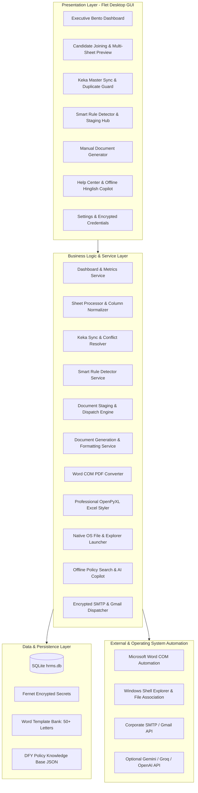
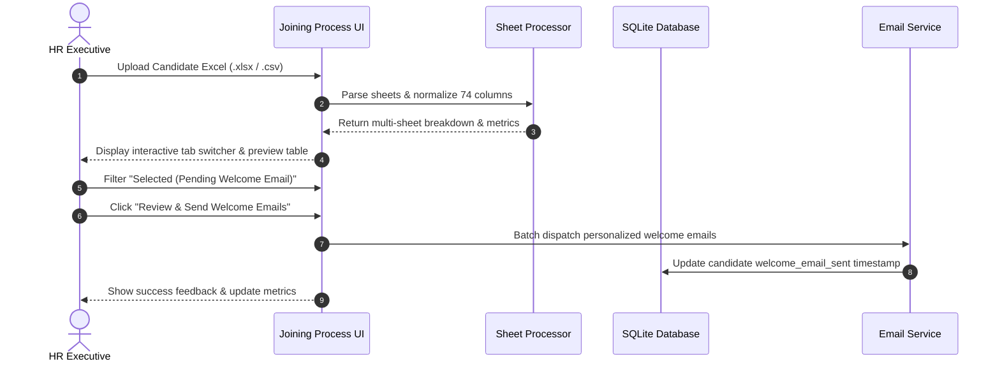
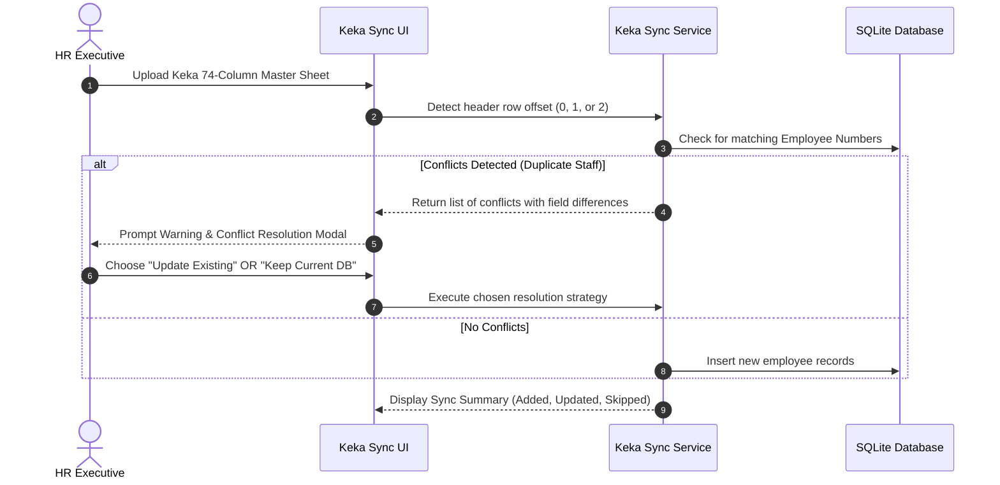
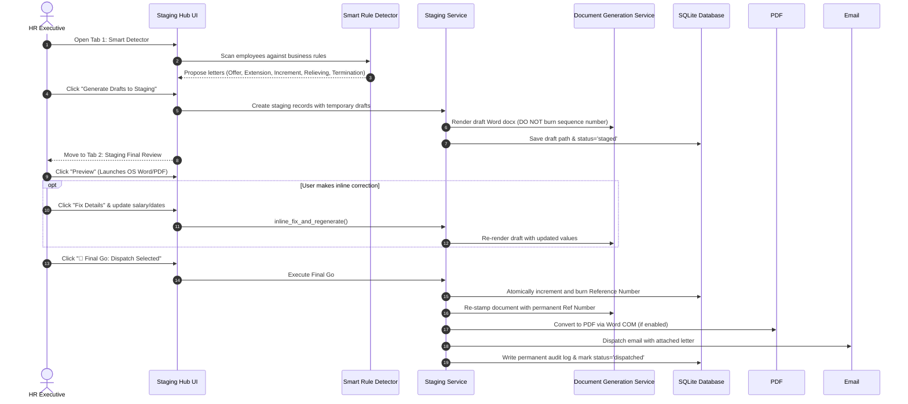

# DFY HRMS Platform — System Architecture & Technical Design

## 1. System Overview

The **Doctors For You (DFY) HR Operations Platform** is an enterprise-grade, offline-first desktop application engineered in Python and [Flet](https://flet.dev/) (Flutter-backed UI framework). It automates and streamlines the entire end-to-end human resources lifecycle across 50+ designations:

1. **Candidate Screening & Joining Pipeline**: Ingests multi-sheet recruitment trackers, detects multi-round interviews, and stages welcome communications.
2. **Keka Master Sync & Duplicate Protection**: Ingests 74-column Keka reports with dynamic banner offset handling and interactive duplicate employee resolution.
3. **Smart Rule Engine**: Evaluates staff employment metrics against 5 core document categories (Offer, Extension, Increment, Relieving/Experience, and Termination).
4. **Staging Review Queue ("Quality Gate")**: Allows human-in-the-loop review, inline editing with real-time document regeneration, and PDF/DOCX format selection before official numbers are committed.
5. **Bulk Dispatch & Audit Hub**: Sequentially burns official reference numbers, renders Word and PDF letters, dispatches via SMTP or Gmail OAuth, and writes immutable audit logs.
6. **Executive Analytics & Professional Export Engine**: Live Bento command center with openpyxl professional styling (DFY navy branding, zebra striping, currency formatting) and 1-click OS file/folder launchers.
7. **Offline DFY HR Policy & Help Copilot**: Built-in 10-Article DFY manual search with Hinglish fallback support that functions with zero internet and without requiring third-party AI keys.

---

## 2. High-Level Architecture Diagram



---

## 3. Core Operational Workflows

### Flow 1: Candidate Ingestion & Welcome Staging


### Flow 2: Keka Ingestion with Zero-Duplicate Guard


### Flow 3: Smart Rule Detection & Staging Quality Gate


---

## 4. Key Engineering Highlights

### 4.1 Word Header Alignment via 2-Column Table
Prior versions suffered from fragile text-padding where spaces between `Ref: DFY/...` and `Date: DD/MM/YYYY` would wrap across lines depending on printer margins and font rendering.
- **Engineered Solution**: In `document_generation_service.py`, header lines are rendered inside an invisible 1-row, 2-column borderless Word table (`w:cantSplit`, left column left-aligned, right column right-aligned). This guarantees 100% horizontal alignment and zero line-wrapping across all Word template variations.

### 4.2 Executive Excel Styler (`excel_export_service.py`)
All Excel exports across the application (Candidate tables, Keka sync logs, Audit trails, and Daily Briefing workbooks) utilize a unified `openpyxl` styling pipeline:
- **Header Banner**: DFY Corporate Navy (`#0B5ED7`), white bold text, centered vertical alignment, 30pt row height.
- **Zebra Striping**: Alternating rows shaded with soft ice-blue (`#F1F5F9`) for readability.
- **Number & Currency Formatting**: Auto-formats salary figures into Indian Rupee style (`₹#,##0`).
- **Autofit Columns**: Dynamically calculates column width based on content length with safety padding.

### 4.3 Native OS File & Explorer Launcher (`utils/file_launcher.py`)
Provides cross-environment desktop actions without external dependencies:
- **`launch_file(path)`**: Uses Windows `os.startfile(abs_path)` to trigger the system's default viewer (Excel, Word, Acrobat).
- **`reveal_in_explorer(path)`**: Invokes `explorer /select,"path"` so the user is immediately taken to the exact folder with the generated file selected.

### 4.4 Offline-First Architecture & Standalone Portability
The system operates completely decoupled from any external cloud server:
- Local SQLite database stored at `data/hrms.db`.
- Local cryptographic key at `data/secret.key`.
- Intelligent directory resolver in `config.py` automatically detects whether the app is executing inside the full Git development repository or as a standalone extracted `desktop_app/` folder.
- Fallback Copilot uses pre-indexed DFY HR Manual JSON (`knowledge/dfy_hr_policy.json`) with keyword and phrase matching in English and Hinglish when no cloud AI API keys are configured.

---

## 5. Repository File Structure

```
Suraj HR Project/
├── Launch_DFY_HRMS.bat            # 1-Click root launcher (probes env & auto-installs deps)
├── Install_Dependencies.bat       # Manual 1-click dependency installer
├── requirements.txt               # Pinned package requirements
├── README.md                      # Comprehensive repository documentation
├── docs/
│   ├── ARCHITECTURE.md            # System architecture and technical design (this file)
│   └── superpowers/               # Implementation plans and design specifications
├── templates/                     # Master Word templates categorized by document type
│   ├── certificate/               # Experience & Relieving certificate templates
│   ├── extension/                 # Service extension templates
│   ├── increment/                 # Salary increment letter templates
│   ├── offer/                     # New hire offer letter templates
│   └── termination/               # Notice & termination templates
├── knowledge/                     # Offline HR manual and help guides
│   ├── dfy_hr_policy.json         # 10 Articles of DFY HR Manual
│   └── app_help_guide.json        # Step-by-step workflow navigation guide
└── desktop_app/                   # Standalone self-contained application package
    ├── Launch_DFY_HRMS.bat        # Standalone 1-click desktop runner
    ├── Install_Dependencies.bat   # Standalone 1-click dependency installer
    ├── requirements.txt           # Standalone dependencies
    ├── main.py                    # Flet GUI application entry point
    ├── config.py                  # Portable configuration & directory resolver
    ├── assets/                    # Organization logos and icons
    ├── data/                      # SQLite database and encryption key
    ├── templates/                 # Self-contained template bank
    ├── knowledge/                 # Self-contained offline knowledge base
    ├── database/                  # SQLite migrations and CRUD operations
    │   └── db_manager.py
    ├── services/                  # Business logic services
    │   ├── ai_service.py
    │   ├── dashboard_service.py
    │   ├── document_formatters.py
    │   ├── document_generation_service.py
    │   ├── document_staging_service.py
    │   ├── email_service.py
    │   ├── excel_export_service.py
    │   ├── hr_report_exporter.py
    │   ├── keka_sync_service.py
    │   ├── pdf_converter_service.py
    │   ├── security.py
    │   ├── sheet_processor.py
    │   └── smart_rule_detector.py
    ├── pages/                     # Flet views and user interfaces
    │   ├── dashboard_page.py
    │   ├── joining_process_page.py
    │   ├── keka_sync_page.py
    │   ├── document_generation_page.py
    │   ├── help_page.py
    │   └── settings_page.py
    ├── utils/                     # UI components, themes, and OS helpers
    │   ├── file_launcher.py
    │   ├── offline_copilot.py
    │   └── ui_theme.py
    └── scripts/                   # Integration tests and regression suites
```
