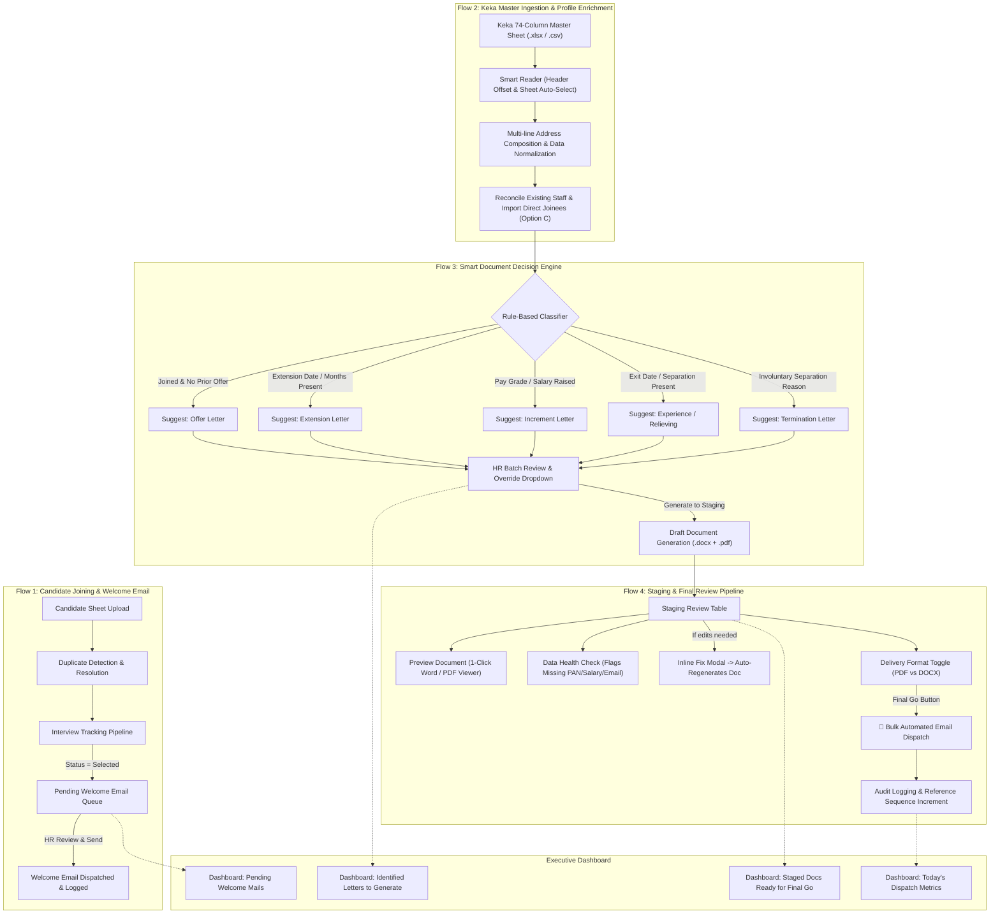

# Design Specification: End-to-End HR Operations Platform & Smart Document Staging Pipeline

**Date**: 2026-10-21  
**Status**: Approved by User  
**Target Architecture**: Option A (Smart Document Pipeline & Staging Hub)  
**System Type**: Python + Flet Desktop Application with SQLite Backend & Word/PDF Engine  

---

## 1. Executive Summary & Purpose

The purpose of this project is to streamline and automate the entire HR lifecycle into two harmonious operational streams:
1. **Flow 1: Candidate Joining Process (Sheet 1)**:
   - Ingestion of candidate screening sheets.
   - Tracking candidates across the interview pipeline.
   - For candidates marked as **Selected**, queuing them into a **Pending Welcome Email Staging Queue**, where HR can review pre-drafted welcome messages and dispatch them individually or in bulk.
2. **Flow 2: Keka Master Ingestion & Smart Document Pipeline (Sheet 2)**:
   - Ingestion of comprehensive 74-column Keka Master Sheets (with automatic header offset detection and multi-line address composition).
   - **Smart Document Decision Engine**: Automatically analyzes employee records and determines required documents (`Offer Letter`, `Extension Letter`, `Increment Letter`, `Experience Certificate`, `Salary Certificate`, `Termination Letter`), while allowing HR override via an inline dropdown.
   - **Staging & Final Review Pipeline (Human-in-the-Loop)**: Rather than immediate dispatch, generated documents are placed into a staging review queue. HR can preview documents, inspect AI data integrity warnings, perform inline corrections (which instantly regenerate the document), select delivery format (default PDF or DOCX), and trigger bulk automated dispatch via the **"🚀 Final Go"** button.
3. **Live Executive Dashboard**:
   - A single-glance command center displaying active counts for pending interviews, pending welcome emails, pending document generations, and staged documents awaiting final dispatch.
4. **1-Click Portable Desktop Launcher**:
   - Zero-terminal desktop runner (`Launch_DFY_HRMS.bat`) allowing any non-technical HR staff to launch the app directly.

---

## 2. Architecture & Data Flow



---

## 3. Database Schema Extensions

### 3.1 `document_staging` Table
Tracks documents that have been generated and are awaiting final HR inspection and dispatch:
```sql
CREATE TABLE IF NOT EXISTS document_staging (
    id INTEGER PRIMARY KEY AUTOINCREMENT,
    candidate_id INTEGER NOT NULL,
    document_type TEXT NOT NULL,
    status TEXT DEFAULT 'Staged', -- 'Staged', 'Approved', 'Dispatched', 'Cancelled'
    doc_file_path TEXT NOT NULL,
    pdf_file_path TEXT,
    preferred_format TEXT DEFAULT 'pdf', -- 'pdf' or 'docx'
    recipient_email TEXT NOT NULL,
    recipient_name TEXT NOT NULL,
    email_subject TEXT NOT NULL,
    email_body TEXT NOT NULL,
    reference_number TEXT,
    extra_fields_json TEXT,
    discrepancy_warnings_json TEXT,
    created_at TEXT NOT NULL,
    updated_at TEXT NOT NULL,
    dispatched_at TEXT,
    FOREIGN KEY(candidate_id) REFERENCES candidates(id) ON DELETE CASCADE
);
```

### 3.2 Candidate Table Welcome Email Extension
Adds tracking columns to the existing `candidates` table:
```sql
ALTER TABLE candidates ADD COLUMN welcome_email_sent INTEGER DEFAULT 0;
ALTER TABLE candidates ADD COLUMN welcome_email_sent_at TEXT;
```

---

## 4. Component Design & Behavioral Specifications

### 4.1 Flow 1: Candidate Joining & Welcome Email Staging
- **Joining Process View (`joining_process_page.py`)**:
  - Existing candidate table retains status dropdown (`Applied`, `Shortlisted`, `Interview`, `Selected`, `Joined`, `Rejected`).
  - When candidate is changed to `Selected`, `welcome_email_sent` remains `0`.
  - A prominent sub-tab or filter badge **"Selected Candidates (Pending Welcome Email)"** shows all candidates who are Selected but have not received their welcome mail.
  - **Action**: HR can select individual candidates or click "Select All" $\rightarrow$ click **"Review & Send Welcome Emails"**.
  - A modal displays the pre-filled personalized welcome email draft:
    - Subject: `Welcome to Doctors For You (DFY) - Selection Confirmation`
    - Body: Congratulatory message, next onboarding steps, HR contact details.
    - Inline editable recipient and body.
  - Upon dispatch, updates `welcome_email_sent = 1` and `welcome_email_sent_at = timestamp`, logs to `email_log`, and notifies HR with a success snackbar.

### 4.2 Flow 2: Smart Document Decision Engine (`keka_sync_page.py` & `document_generation_service.py`)
- **Detection Rules**:
  1. **Offer Letter**:
     - `candidate.status == 'Joined'` or `employment_status == 'Active'`
     - No prior Offer Letter recorded in `document_generation_log` or `document_staging`.
     - Suggestion: `Offer Letter`.
  2. **Extension Letter**:
     - `extension_of_service_till` or `extension_of_service_months` is present, OR candidate's calculated contract end date is within 30 days.
     - Suggestion: `Extension Letter`.
  3. **Increment Letter**:
     - `pay_grade` or `negotiated_salary` is updated and higher than previously recorded value.
     - Suggestion: `Increment Letter`.
  4. **Experience / Relieving Certificate**:
     - `exit_date` is populated, OR `exit_status` indicates voluntary separation/resignation.
     - Suggestion: `Experience Certificate`.
  5. **Termination Letter**:
     - `termination_type` or `termination_reason` is populated.
     - Suggestion: `Termination Letter`.

- **Auto-Detection Screen**:
  - Displayed immediately after sheet upload or on the **Smart Generator** page.
  - Table columns: `Employee Code`, `Full Name`, `Detected Status / Trigger Reason`, `Suggested Letter Badge`, `Override Dropdown`, `Select Checkbox`.
  - Override dropdown contains: `Offer Letter`, `Appointment Letter`, `Increment Letter`, `Extension Letter`, `Experience Certificate`, `Salary Certificate`, `Termination Letter`, `Skip / None`.
  - Action Button: **"Generate Selected to Staging"**.
  - Generates Word document (`.docx`), attempts conversion to `.pdf`, prepares personalized email draft, runs anomaly detection, and inserts records into `document_staging` with status `'Staged'`.

### 4.3 Flow 3: Staging & Final Review Pipeline (Human-in-the-Loop)
- **Staging Table (`Staging Queue`)**:
  - Displays all items where `status = 'Staged'`.
  - Columns:
    1. Checkbox for batch selection (with "Select All" header).
    2. Employee Name & ID.
    3. Document Type badge.
    4. Recipient Email (editable).
    5. Anomaly Pill: `✅ Ready` or `⚠️ [N] Issues` (hover/click shows details like missing salary, short mobile, unverified PAN).
    6. Delivery Format Toggle: `PDF` (default) vs `DOCX`.
    7. Action Icons:
       - 👁️ **Preview**: Opens generated `.docx` or `.pdf` using OS default viewer.
       - ✏️ **Fix Details**: Opens modal to correct name, dates, salary, or designation. Upon saving, database is updated and the Word/PDF documents are **instantly re-generated** with corrected details.
       - ✉️ **Send Single**: Dispatches only this candidate immediately.
       - 🗑️ **Discard**: Removes draft from staging without sending.
- **The "Final Go" Bulk Dispatcher**:
  - Prominent primary button: **`[ 🚀 Final Go: Dispatch Selected (N Documents) ]`**.
  - Shows explicit confirmation summary: Total emails to send, count of PDFs vs DOCXs, and list of recipients.
  - On approval:
    - Dispatches emails asynchronously using the background queue or immediate pool.
    - Consumes official Reference Numbers sequentially only upon final approval.
    - Transitions staging status to `'Dispatched'`.
    - Logs to `email_log` and `document_generation_log`.
    - Displays non-blocking progress ring and success report.

### 4.4 Flow 4: Executive Dashboard Enhancements (`dashboard_page.py`)
- Real-time action cards:
  - **In Interview Pipeline**: Count of active applicants.
  - **Pending Welcome Emails**: Count of selected candidates needing welcome emails (clicking navigates directly to Welcome Mail Queue).
  - **Identified Letters to Generate**: Count of staff detected from Keka sheet needing letters (clicking opens Smart Detector).
  - **Staged Documents Awaiting Final Go**: Count of letters currently sitting in the review pipeline (clicking opens Staging Queue).
  - **Today's Dispatch Health**: Total sent today vs failed.

### 4.5 Flow 5: 1-Click Desktop Launcher
- File: `Launch_DFY_HRMS.bat` in repository root.
- Checks Python environment, activates virtual environment if present, initializes SQLite schema safely, and launches `desktop_app/main.py`.
- Includes shortcut icon creation script for Windows Desktop.

---

## 5. Error Handling & Data Safety Rules

1. **Non-Technical User Messages**: All error alerts, confirmation dialogs, and progress bars use plain non-technical language.
2. **Zero Overwrite of Existing Data**: Blank cells in uploaded sheets will never overwrite existing non-empty database fields.
3. **Reference Number Sequence Conservation**: Sequence numbers are strictly incremented only when documents are approved for Final Go dispatch, never during draft preview or staging generation.
4. **PDF Fallback**: If PDF conversion engine is unavailable on a client machine without MS Word/LibreOffice, the system automatically falls back to `.docx` delivery without crashing.
5. **Foreign Key Safety**: Deleting or archiving a candidate properly cleans up or archives linked staging records via cascade triggers.

---

## 6. Implementation Verification Plan

1. **Unit Tests**:
   - `test_document_staging_crud.py`: Create, update, fix/regenerate, and dispatch staging records.
   - `test_smart_rule_detector.py`: Verify detection rules for Offer, Extension, Increment, Relieving, Termination.
   - `test_welcome_email_queue.py`: Verify welcome email staging for Selected candidates.
2. **Integration Tests**:
   - `test_staging_pipeline_end_to_end.py`: Upload Keka sheet $\rightarrow$ Smart detect $\rightarrow$ Generate to Staging $\rightarrow$ Inline Fix $\rightarrow$ Final Go dispatch $\rightarrow$ Verify email log and sequence increment.
3. **Regression Suite**:
   - Ensure all existing 11 test suites pass with 100% success rate.
